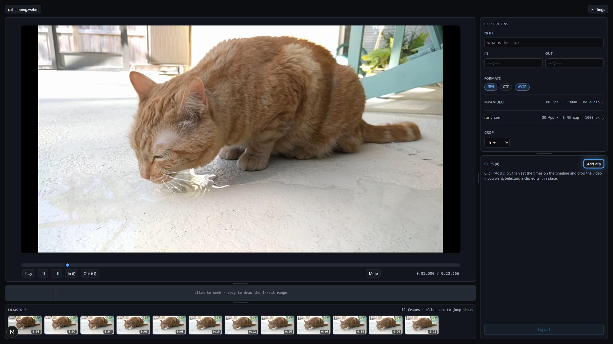
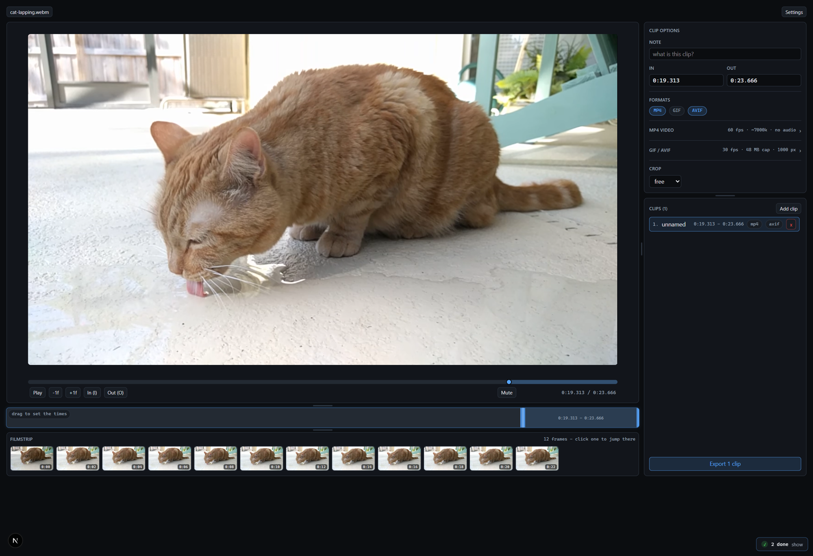
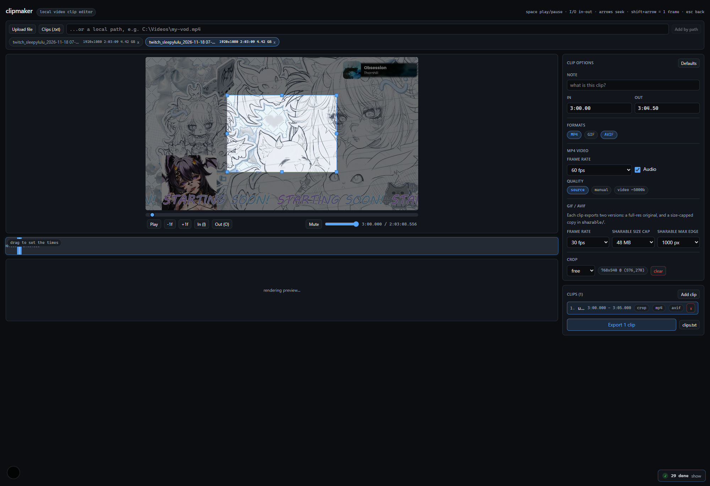
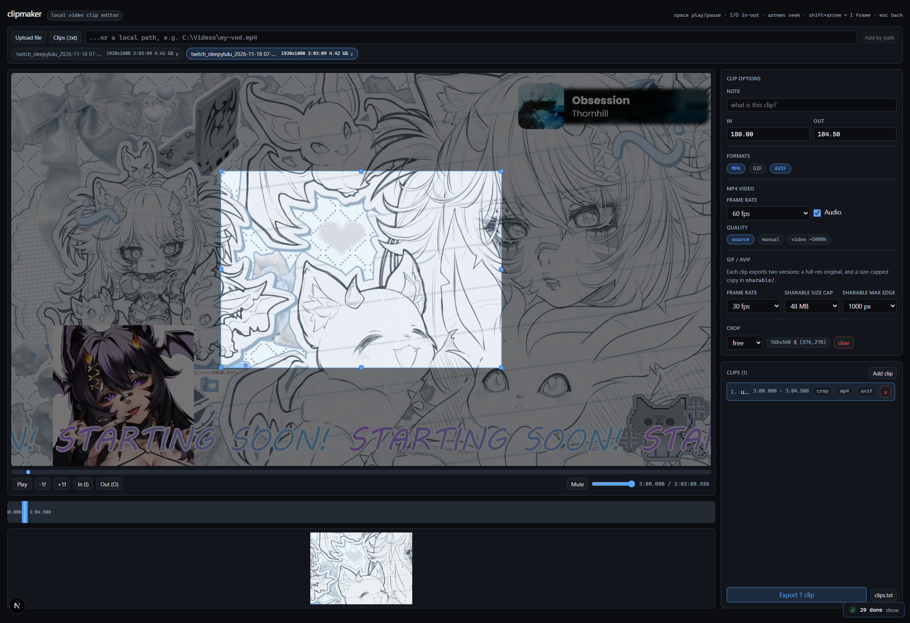

# clipmaker

A local web app for cutting clips out of your own videos. Load a video from
your disk (or upload a file), scrub it, mark in/out points, optionally crop
and rotate the frame (to level a tilted shot), mute the audio, pick a
quality and frame rate, and export each
clip as an MP4 and/or a GIF and/or an animated AVIF. Every GIF/AVIF export
comes in two versions: a full-quality, full-resolution original, and a
size-capped "sharable" copy that fits the cap you set.

Everything runs on your machine: the video files never leave it, and
exports are encoded with your local `ffmpeg` (NVENC GPU encoding is
used automatically when available). Your clip lists are saved per
video as project files (`.data/clips.json`), and your default export
settings for new clips (`.data/defaults.json`) survive reloads and
restarts.

## At a glance



Freshly loaded: the video plays on the left, the clip queue is on the
right. "Add clip" glows until you pick a starting point.



Setting the times: the timeline below the player glows - drag on it to
mark the in and out points.



Optional crop: drag a rectangle over the frame - the crop updates live
while you drag.



The finished clip: the crop box sits over the frame, the timeline holds
the in/out range, and the clip (with its MP4/AVIF and crop chips) is
ready in the queue.

## How to run

Prerequisites:

- [Bun](https://bun.sh) on your PATH
- `ffmpeg` and `ffprobe` on your PATH (or set the `CLIPMAKER_FFMPEG` /
  `CLIPMAKER_FFPROBE` environment variables to their paths; a Chocolatey
  install location is also tried as a fallback)

```
bun install
bun run dev
```

Then open **http://localhost:10100**.

For the optimized version: `bun run prod` (builds, then starts - same
port).

## How to use it

1. **Load a video** - either type a local file path (recommended for big
   files: it is used in place, never copied) or upload a file (copied
   into `uploads/`). To import a batch of clips from a notes file in
   one go, see [Clips from a notes file](#clips-from-a-notes-file).
2. **Pick a range** - click the timeline to seek, drag on it to draw
   the in/out range (right-click the range to clear it), or press
   `I` (in) and `O` (out) at the playhead. Without a range, playback
   runs free; with a range set, playback loops it so you can preview
   the clip. Space toggles playback; `Shift` + arrow seeks one frame.
   Scroll on the timeline to zoom - 10 seconds at closest, the whole
   video at furthest; `Shift` + scroll or `Shift` + drag pans the
   view, and double-click (or the `fit` button) returns to the whole
   video. While dragging the range near a track edge, the view
   auto-scrolls, so you can carry a clip across the whole video.
   While you drag the in/out handles (or draw a new range), playback is
   temporarily paused so the frame under your pointer stays exactly
   where you put it; if it was playing, it resumes when you let go.
3. **Crop (optional)** - click and drag a rectangle over the video (a
   plain click plants a small crop at that point; with a crop already
   there, a click outside it keeps it). You can move it,
   resize it from any of the 8 handles, and lock the aspect ratio
   (16:9, 1:1, source). To straighten a tilted shot, grab the round
   handle just outside a corner and drag - the crop turns about its
   center and is exported level (no black corners). A live preview shows the
   exact frame that will
   be exported. Clicking the video never starts playback - use the
   Play button or `space`.
   A thin scrub bar sits directly under the video: click or drag it
   to jump anywhere; the active in/out range shows as a band.
4. **Tune the export** - per clip: note, formats (mp4, gif, avif - any
   combination; new and imported clips default to MP4 + AVIF, GIF is the
   opt-in fallback), audio on/off, frame rate (MP4: 25/30/60, default
   60; GIF/AVIF: 15/20/25/30/60, default 30), MP4 quality (matched to the
   source by default, or a manual bitrate), and for GIFs/AVIFs a size cap
   (10/25/48 MB) plus a maximum edge length (256-1440 px, default 1000)
   for the sharable copy - it is never upscaled, so a crop smaller than
   the max edge just keeps the best resolution it has. The full-res
   original is always exported with it, no cap. AVIF encodes are slow,
   so a clip that includes AVIF warns in yellow once it is longer than
   45 seconds and in red above 60 seconds. The **Settings** page (the
   Settings button in the top bar) sets these options once for all new
   and imported clips (persisted in `.data/defaults.json`); existing
   clips always keep their own settings.
5. **"Add clip"** starts a clip: it is created right away (at the
   playhead if you have not marked a range yet) and selected, and the
   app guides you - the timeline glows so you can set the exact times,
   then the player glows if you want a crop. Every change updates the
   selected clip in place, and everything is saved automatically, so
   your clips are there after a reload. Selecting an existing clip
   edits it the same way. You can queue several clips from one video
   and export them all at once.
6. **Export** - clicking "Export" first opens an export plan: your
   clips as a card list with a checkbox each (all ticked by default), a
   select-all, and a **"combined highlights"** pane with a checkbox on
   every group of clips that share the same note (part count and total
   length per group, plus a "combine all groups" box). Every ticked
   clip is exported individually; each ticked group ADDS one MP4
   "highlights" file on top of its parts - its selected clips merged
   with a 0.5s fade in and out per part, named
   `highlights/<note>-highlights.mp4` (in its own `highlights/` folder;
   combined files are MP4 only, no GIF/AVIF,
   and a group needs 2+ selected clips). Every combined file also gets
   a sharable copy (`sharable/<note>-highlights.mp4`): one short file
   that shows a bit of every part - each part contributes its middle
   (about 3 minutes of content total, 8-15s per part) with a fade in
   and out, re-encoded at a fixed 30fps with the longest edge starting
   at full resolution and stepping down 1080, 768, 512, or 256 (the
   first size that fits under 48MB), small enough
   to send over chat no matter how long the highlights file is. The footer shows how many
   clips and how many exports the plan produces. Unticked clips are
   skipped. "Start export" closes the plan and starts the jobs;
   several jobs run in parallel (two at a time by default, raise it
   with the CLIPMAKER_CONCURRENCY env var).
   A front-and-center export view opens: an overall progress bar plus a
   progress bar and stage text per clip (e.g. `gif: sharable 512p25
   (8/12)`), and download links for every finished file. While it is
   working you can minimize it to a small pill in the bottom-right
   corner ("show" reopens it); when everything is done it stays open
   with the outputs until you close it. Any queued or running row has a
   cancel button: it stops just that job (kills its ffmpeg process and
   deletes its temp files) and marks it `cancelled by user`, leaving
   the rest of the batch to finish. Files are also written to
   `out/<video-id>/` on disk, sharable copies in
   `out/<video-id>/sharable/`, and the combined highlights file in
   `out/<video-id>/highlights/`. When the video's file name carries a
   broadcast date (e.g. a Twitch download named
   `twitch_user_2026-11-19 07-03-30_...`), the video id starts with it
   (`2026-11-19_ab12cd34`) so the folders sort chronologically, and
   the export files sit in a subfolder of just that date
   (`out/<video-id>/2026-11-19/`). In/out points keep their sub-second
   precision (shown to the millisecond in the clip list and timeline),
   and the exported clip starts on the exact frame at the in-point.

Clicking a clip in the list jumps the player to that clip's start and
selects it as a preview, and the timeline zooms in around the clip
(5 seconds of margin on each side) so you can fine-tune its in/out
points on the track. Click on empty space, press `Esc`, or use the
back button in the transport row to return to where you were and
deselect the clip.

**Resizing the layout** - on wide screens, drag the thin grip between
two panels (player / timeline / filmstrip, left / right column,
options / clip list) to make them bigger or smaller; double-click a
grip to put that panel back to its natural size. Your arrangement is
remembered across reloads.

Keyboard: `space` play/pause, `I`/`O` in/out, `left`/`right` seek,
`shift` + `left`/`right` = one frame, `esc` back from a clip preview (deselects it).
The arrow keys still seek the video even when a button (e.g. a format
pill) has focus.

## Clips from a notes file

If you keep notes about what to clip, you can import them in one go:

1. Load the video the notes are about and keep it active.
2. In the video loader, click **"Clips (.txt)"** and pick your notes
   file.

File format - one clip per line:

```txt
# my-vod-2026-10-21.mp4
14:47 - 15:22 Funny
20:42 - 20:58 Cute Cat

1:01:41 - 1:02:54 Cat falls off the couch
```

- Times are `m:ss` or `h:mm:ss` (plain seconds also work).
- The text after the end time becomes the clip's note (optional).
- A `# header` line starts a section for a different video. When a file
  has several sections, only the one whose header contains the active
  video's file name is imported; when none matches, nothing is imported
  and the mismatch is reported instead.
- Blank lines are ignored and unparseable lines are skipped. Ranges are
  clamped to the video's length.

Imported clips get the default settings (MP4 + AVIF, audio on, MP4 at
60 fps, GIF/AVIF at 30 fps - configurable in the **Settings** page in
the top bar) and can be adjusted individually in the queue before
export.

The other direction is automatic: every time your clip list is saved,
clipmaker writes `out/<video-id>/timestamps.txt` - one
`<start> - <end> <note>` line per clip, sub-second timestamps included
- in exactly this format. It is also re-established whenever an export
job for the video finishes, so deleting the export folder (or just the
file) and re-exporting brings it back. Copy it into your notes file
(or merge it into a multi-video one) and it imports cleanly again.
The file is deleted when the clip list becomes empty.

## Ingest folder for huge files

Browser uploads of very large files are slow. The third way to load a
video: drop a file into an ingest folder and refresh the page.

1. Create an `ingest/` folder in the project root (or point
   `CLIPMAKER_INGEST_DIR` at any folder you like, e.g. a mount).
2. Copy a video into it - even while it is still copying.
3. Navigate to the page (or refresh it).

On every page load, clipmaker probes each file in the folder and moves
the good ones into `uploads/`, loading them as videos. A freshly
ingested video becomes the active one, and a one-line report under the
video loader says what happened:

- **still writing** - the file is still being written (or still locked
  by the copy in progress); it is picked up on the next refresh.
- **ingest failed** - the file could not be probed. It is moved to
  `ingest/failed/` with a `.err` file next to it that explains why.

Note: ingested files are *moved*, not copied, and are treated like
uploads - removing the video from the app deletes its export files, and
for uploaded/ingested videos also the file itself from disk. If the
original must stay in place, use "Add by path" instead.

## Limitations

- Exports run a few at a time (two in parallel by default); the rest
  queue in order.
- Exports are always re-encoded (no stream-copy), so even "source"
  quality takes a moment; NVENC makes this fast on supported GPUs.
- Uploaded files are copied into `uploads/`; for very large files prefer
  the local-path option (references the file in place) or the ingest
  folder (moves the file into `uploads/`).
- The app assumes it runs on the same machine as the videos (it cannot
  reach paths on other hosts).
- GIFs are built in three stages (cut, palette, encode); the sharable
  copy shrinks automatically through ever smaller sizes and slightly
  lower frame rates (alternating) until it fits the size cap, and the
  job fails with an error if even the smallest rung exceeds it. The full-res copy has no cap and can be large (a 10s 1080p
  GIF is easily 100 MB+).
- Animated AVIF needs an ffmpeg with an AV1 encoder (`libsvtav1` is
  preferred, `libaom-av1` is the fallback); without one the AVIF jobs
  fail with a clear error and the MP4/GIF exports are unaffected. AVIF
  encodes are slower than GIFs but far smaller at the same quality.
  The sharable AVIF copy shrinks the same way as the sharable GIF -
  size and frame rate first, then quality.
- The sharable copy of a combined highlights file is not the finished
  file shrunk - it is a condensed cut: every part contributes its
  middle section (about 3 minutes of content total, 8-15s per part),
  re-encoded at a fixed 30fps with the longest edge starting at full
  resolution and stepping down 1080, 768, 512, or 256 (never upscaled,
  48MB cap, audio at 96k). When even the
  smallest size exceeds the cap, the full file is kept and the job
  shows a warning instead of failing. The full highlights file itself
  is always one file, no matter how long.
- Session data (loaded videos, clip lists, job history, new-clip
  defaults) lives in `.data/`; running jobs are not resumable after a
  server restart.
- The web UI needs a browser with `fetch` streaming for uploads; it is
  tested in Chromium.

## Getting help

- Check the browser console and the terminal running the dev server for
  errors.
- `bun test` runs the unit test suite; `bunx tsc --noEmit` typechecks.
- Job errors and warnings are shown in the export view (e.g. a GIF that
  could not be shrunk to the cap).
- File issues to the repo's issue tracker.
