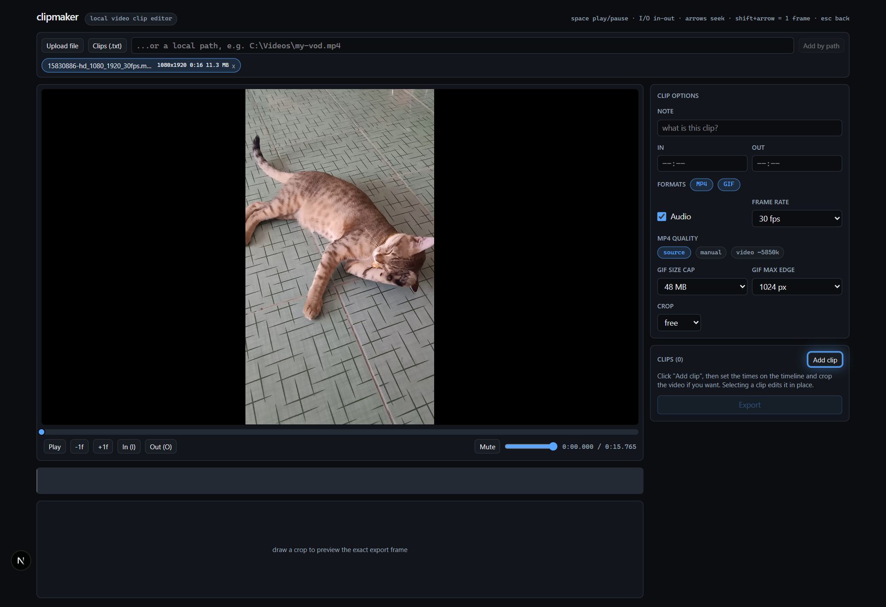
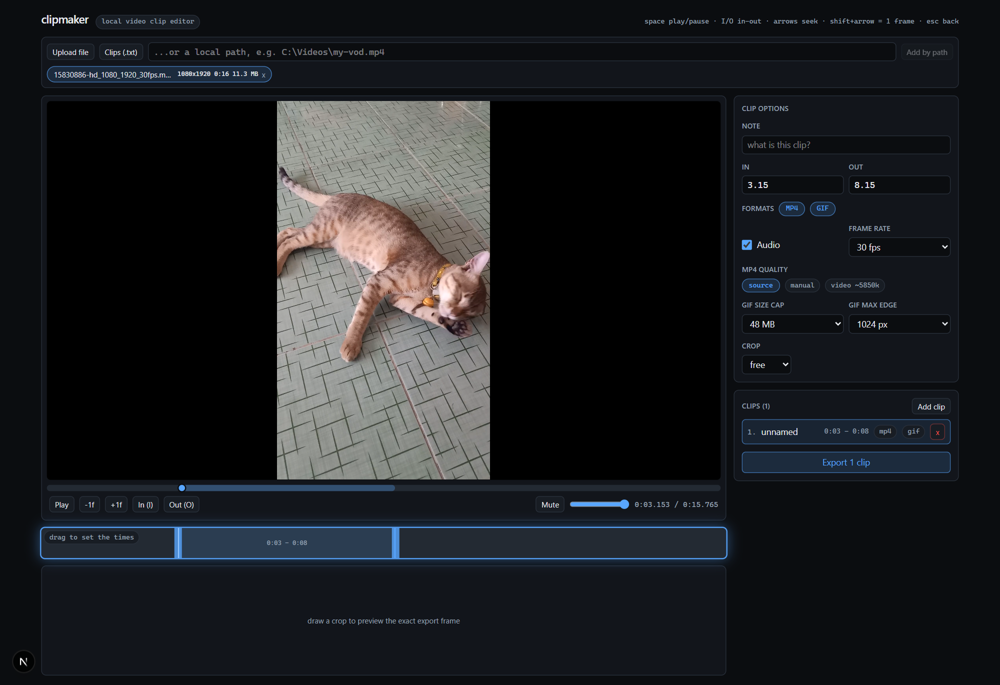
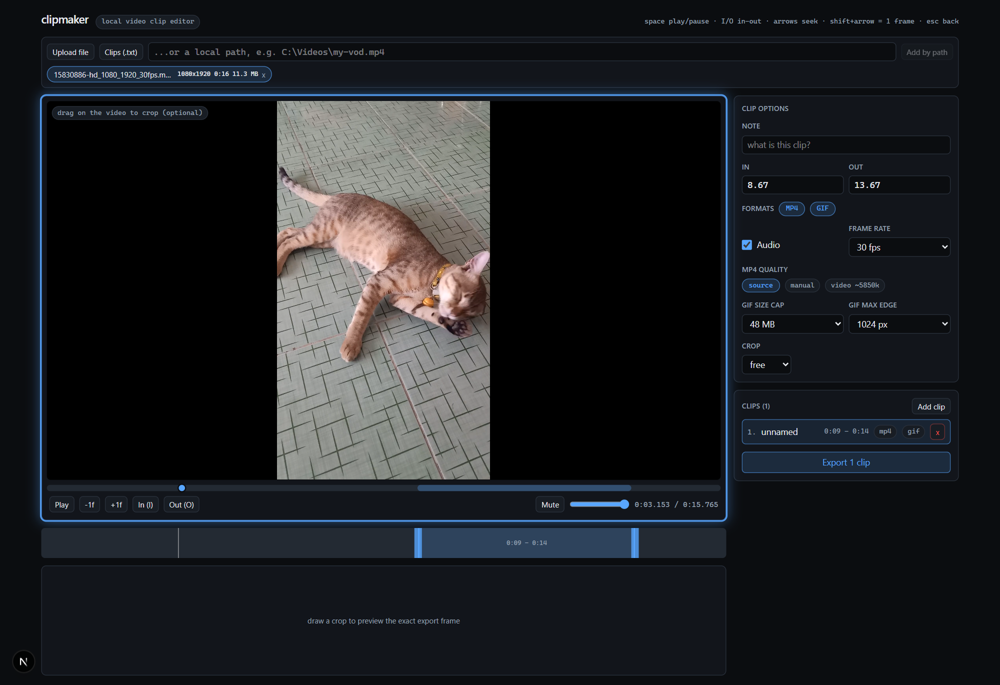
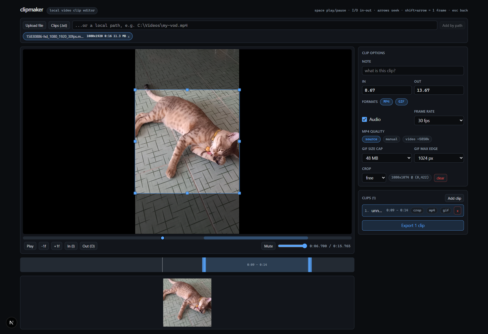

# clipmaker

A local web app for cutting clips out of your own videos. Load a video from
your disk (or upload a file), scrub it, mark in/out points, optionally crop
the frame, mute the audio, pick a quality and frame rate, and export each
clip as an MP4 and/or a GIF.

Everything runs on your machine: the video files never leave it, and
exports are encoded with your local `ffmpeg` (NVENC GPU encoding is
used automatically when available). Your clip lists are saved per
video as project files (`.data/clips.json`) and survive reloads and
restarts.

## At a glance



Freshly loaded: the video plays on the left, the clip queue is on the
right. "Add clip" glows until you pick a starting point.



Setting the times: the timeline below the player glows - drag on it to
mark the in and out points.



Optional crop: the player glows while you drag a rectangle over the
frame.



The finished clip: the crop box sits over the frame, the timeline holds
the in/out range, and the clip (with its MP4/GIF and crop chips) is
ready in the queue.

## How to run

Prerequisites:

- [Bun](https://bun.sh) on your PATH
- `ffmpeg` and `ffprobe` on your PATH (or set the `CLIPMAKER_FFMPEG` /
  `CLIPMAKER_FFPROBE` environment variables to their paths; a Chocolatey
  install location is also tried as a fallback)

```
bun install
bun run dev
```

Then open **http://localhost:10100**.

For a production build: `bun run build && bun run start` (same port).

## How to use it

1. **Load a video** - either type a local file path (recommended for big
   files: it is used in place, never copied) or upload a file (copied
   into `uploads/`). To import a batch of clips from a notes file in
   one go, see [Clips from a notes file](#clips-from-a-notes-file).
2. **Pick a range** - click the timeline to seek, drag on it to draw
   the in/out range (right-click the range to clear it), or press
   `I` (in) and `O` (out) at the playhead. Without a range, playback
   runs free; with a range set, playback loops it so you can preview
   the clip. Space toggles playback; `Shift` + arrow seeks one frame.
   Scroll on the timeline to zoom - 10 seconds at closest, the whole
   video at furthest; `Shift` + scroll or `Shift` + drag pans the
   view, and double-click (or the `fit` button) returns to the whole
   video. While dragging the range near a track edge, the view
   auto-scrolls, so you can carry a clip across the whole video.
3. **Crop (optional)** - click and drag a rectangle over the video (a
   plain click plants a small crop at that point). You can move it,
   resize it from any of the 8 handles, and lock the aspect ratio
   (16:9, 1:1, source). A live preview shows the exact frame that will
   be exported. Clicking the video never starts playback - use the
   Play button or `space`.
   A thin scrub bar sits directly under the video: click or drag it
   to jump anywhere; the active in/out range shows as a band.
4. **Tune the export** - per clip: note, formats (mp4, gif, both), audio
   on/off, frame rate (25/30/60), MP4 quality (matched to the source by
   default, or a manual bitrate), and for GIFs a size cap (10/25/48 MB)
   plus a maximum edge length (256-1024 px).
5. **"Add clip"** starts a clip: it is created right away (at the
   playhead if you have not marked a range yet) and selected, and the
   app guides you - the timeline glows so you can set the exact times,
   then the player glows if you want a crop. Every change updates the
   selected clip in place, and everything is saved automatically, so
   your clips are there after a reload. Selecting an existing clip
   edits it the same way. You can queue several clips from one video
   and export them all at once.
6. **Export** - jobs run one after another (GPU encoding keeps them fast,
   but only one runs at a time). When a job finishes, download links for
   the MP4 and GIF appear in the EXPORTS panel. Files are also written to
   `out/<video-id>/` on disk.

Clicking a clip in the list jumps the player to that clip's start and
selects it as a preview, and the timeline zooms in around the clip
(5 seconds of margin on each side) so you can fine-tune its in/out
points on the track. Click on empty space, press `Esc`, or use the
back button in the transport row to return to where you were and
deselect the clip.

Keyboard: `space` play/pause, `I`/`O` in/out, `left`/`right` seek,
`shift` + `left`/`right` = one frame, `esc` back from a clip preview (deselects it).

## Clips from a notes file

If you keep notes about what to clip, you can import them in one go:

1. Load the video the notes are about and keep it active.
2. In the video loader, click **"Clips (.txt)"** and pick your notes
   file.

File format - one clip per line:

```txt
# my-vod-2026-10-21.mp4
14:47 - 15:22 Funny
20:42 - 20:58 Cute Cat

1:01:41 - 1:02:54 Cat falls off the couch
```

- Times are `m:ss` or `h:mm:ss` (plain seconds also work).
- The text after the end time becomes the clip's note (optional).
- A `# header` line starts a section for a different video. When a file
  has several sections, only the one whose header contains the active
  video's file name is imported; when none matches, nothing is imported
  and the mismatch is reported instead.
- Blank lines are ignored and unparseable lines are skipped. Ranges are
  clamped to the video's length.

Imported clips get the default settings (MP4 + GIF, audio on, 30 fps)
and can be adjusted individually in the queue before export.

## Limitations

- One export job at a time (jobs queue in order).
- Exports are always re-encoded (no stream-copy), so even "source"
  quality takes a moment; NVENC makes this fast on supported GPUs.
- Uploaded files are copied into `uploads/`; for very large files prefer
  the local-path option.
- The app assumes it runs on the same machine as the videos (it cannot
  reach paths on other hosts).
- GIFs are built in three stages (cut, palette, encode) and shrink
  automatically (resolution, then frame rate) until they fit the size cap;
  if even the lowest rung exceeds the cap the job fails with an error.
- Session data (loaded videos, clip lists, job history) lives in
  `.data/`; running jobs are not resumable after a server restart.
- The web UI needs a browser with `fetch` streaming for uploads; it is
  tested in Chromium.

## Getting help

- Check the browser console and the terminal running the dev server for
  errors.
- `bun test` runs the unit test suite; `bunx tsc --noEmit` typechecks.
- Job errors and warnings are shown inline in the EXPORTS panel (e.g. a
  GIF that could not be shrunk to the cap).
- File issues to the repo's issue tracker.
